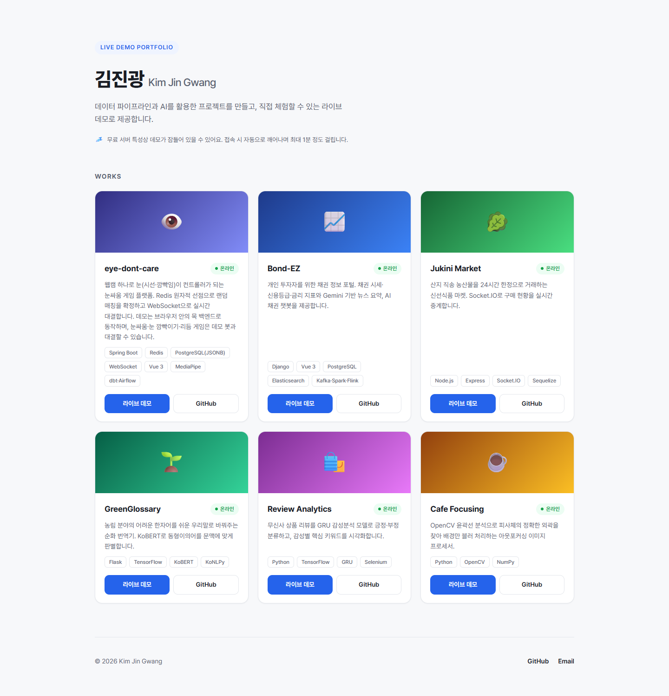

# 🚪 라이브 데모 게이트웨이 (demo-gateway)

> **프로젝트 라이브 데모를 한곳에 모았습니다.**
>
> **Project Date:** 2026.08 ~ 2026.09 · **개인 프로젝트**
>
> **Platform:** 정적 웹 (HTML · CSS · JavaScript) · Cloudflare · Hugging Face Spaces API
>
> **Live:** https://demo-gateway.trealight112.workers.dev/

여러 프로젝트의 라이브 데모를 **카드 목록 한 페이지**로 보여 주는 포트폴리오 사이트입니다. 빌드 과정이 없는 정적 사이트로 Cloudflare에 배포되며, push할 때마다 자동으로 재배포됩니다.

카드 7개 중 4개는 이 저장소 안의 **전용 데모 프론트엔드**로, 나머지 3개는 **외부에 호스팅된 데모**로 연결됩니다. 전용 프론트엔드는 화면만 담당하고 연산은 Hugging Face Spaces API가 맡습니다.

---

## 📱 실제 화면

| 프로젝트 목록 |
|:---:|
|  |
| 프로젝트 카드마다 서버 상태를 표시하고 데모와 저장소로 연결 |

---

## 📖 프로젝트 개요

데모들은 프로젝트마다 호스팅 위치가 다르고(이 저장소, Cloudflare Pages, Render), 무료 서버 특성상 잠들어 있다가 접속 시 깨어나는 데 최대 1분 정도 걸릴 수 있습니다.
게이트웨이는 이 데모들을 **카드 한 장 + 상태 배지**로 한 페이지에 모읍니다.

* **한 페이지에서 바로 체험** — 프로젝트 설명·기술 태그·라이브 데모·GitHub 링크를 카드 하나에 배치
* **서버 상태를 먼저 알려 줌** — 접속하면 데모 서버에 핑을 보내 배지를 `온라인` / `슬립 중`으로 갱신
* **빌드 없는 운영** — `index.html`의 `PROJECTS` 배열만 고치고 push하면 카드가 추가·활성화됨

### 💡 주요 기능

| 기능 | 설명 |
|---|---|
| 🗂️ **프로젝트 카드 목록** | `PROJECTS` 배열을 읽어 카드를 그림. `demoUrl`이 비어 있으면 버튼이 `데모 준비 중`으로 비활성화 |
| 🟢 **상태 배지** | 카드마다 `healthUrl`로 요청을 보내 5초 안에 응답하면 `온라인`, 실패하면 `슬립 중`으로 표시 |
| 💤 **웨이크업 안내** | `sleeps: true`인 데모를 슬립 상태에서 누르면 "서버를 깨우는 중" 안내를 띄운 뒤 새 탭으로 이동 |
| 🎛️ **전용 데모 프론트엔드** | Cafe-Focusing · GreenGlossary · Review Analytics 데모 화면을 저장소 안에서 직접 제공 |
| 🌗 **공통 디자인 토큰** | 게이트웨이와 데모 페이지가 같은 색·폰트 변수를 쓰고, 시스템 설정에 따라 다크 모드로 전환 |

---

## 🏗️ 아키텍처 — 화면과 연산을 나눈 2-티어

**요청 흐름 (카드 클릭 → 데모 결과)**

1. 게이트웨이(`index.html`)가 `PROJECTS` 배열로 카드를 그리고, 각 `healthUrl`에 핑을 보내 배지를 갱신
2. 카드의 `라이브 데모` 버튼은 새 탭으로 열림 — 저장소 안의 전용 프론트엔드는 상대 경로, 외부 데모는 절대 URL
3. 전용 프론트엔드는 브라우저에서 `@gradio/client`(jsdelivr ESM)를 불러와 해당 Hugging Face Space에 연결
4. Space의 API(`/focus_image` · `/simplify` · `/analyze` 등)를 직접 호출해 받은 결과를 화면에 표시
5. Space가 잠들어 있으면 페이지의 배지가 `깨우는 중`으로 바뀌고, 처리 안내 문구로 대기 시간을 알림

> 무거운 연산을 Hugging Face Spaces에 두고 화면은 정적 파일로만 구성해, 게이트웨이 자체는 서버와 빌드 과정 없이 운영합니다.

---

## 🧭 데모 구성

| 프로젝트 | 데모 화면 | 연산·백엔드 |
|---|---|---|
| **VerMap** | 이 저장소 `vermap/` | 없음 — 화면 안에서 만든 예시 자료로 동작하는 정적 데모 |
| **Cafe Focusing** | 이 저장소 `cafe-focusing/` | Hugging Face Space (GreenGlossary와 같은 Space 공유) |
| **GreenGlossary** | 이 저장소 `greenglossary/` | Hugging Face Space (Cafe Focusing과 같은 Space 공유) |
| **Review Analytics** | 이 저장소 `review-analytics/` | Hugging Face Space (전용) |
| **Bond-EZ** | 외부 — Cloudflare Pages | Render |
| **Jukini Market** | 외부 — Render | Render (슬립 가능, 웨이크업 안내 대상) |
| **eye-dont-care** | 외부 — Cloudflare Pages (`eye-dont-care.pages.dev`) | 브라우저 안의 목 백엔드로 동작하는 정적 데모 |

**전용 데모 프론트엔드가 제공하는 화면**

| 데모 | 화면 |
|---|---|
| **Cafe-Focusing** | 드래그 앤 드롭·Ctrl+V 입력, 샘플 이미지 원클릭 체험, 피사체 검출 방식 4종 선택, 원본↔결과 비교 슬라이더 |
| **GreenGlossary** | 샘플 문장 선택, 원문과 순화된 문장 비교, 바뀐 용어 목록 |
| **Review Analytics** | 샘플 리뷰 묶음·CSV/텍스트 업로드, 긍정·판단 유보·부정 비율, 확신도 분포, 키워드로 리뷰 필터, 문장 단위 판정 |

---

## 🛠️ 기술 스택

| 영역 | 스택 |
|---|---|
| **프론트엔드** |    Pretendard (jsdelivr CDN) |
| **데모 API 연동** |  `@gradio/client` (jsdelivr ESM) |
| **호스팅** |  push 시 자동 재배포 |
| **외부 데모** |   |

---

## 📂 디렉터리 구조

```text
demo-gateway/
├── index.html            # 게이트웨이 메인 — PROJECTS 배열 · 카드 렌더링 · 헬스체크 · 웨이크업 안내
├── cafe-focusing/        # Cafe-Focusing 전용 데모 프론트엔드
├── vermap/               # VerMap 화면 데모 (대시보드 · 버전 히트맵 · 버전 리플레이)
│   ├── index.html        #   드래그 앤 드롭·Ctrl+V 입력, 원본↔결과 비교 슬라이더
│   └── sample.png        #   원클릭 체험용 샘플 이미지
├── greenglossary/        # GreenGlossary 데모 프론트엔드
│   └── index.html        #   문장 입력 → 순화 결과·바뀐 용어 표시
└── review-analytics/     # Review Analytics 데모 프론트엔드
    └── index.html        #   리뷰 입력·파일 업로드 → 감성 비율·키워드·문장 단위 판정
```

---

## 🚀 실행 방법

**요구 사항:** 웹 브라우저 · 정적 파일 서버 (빌드 도구·의존성 설치 없음)

```bash
python -m http.server 8000   # 저장소 루트에서 실행 후 http://localhost:8000 접속
```

배포는 별도 명령 없이 **push하면 Cloudflare가 자동으로 재배포**합니다.

전용 데모 페이지는 주소 뒤에 `?api=<Space 주소>`를 붙이면 기본 Space 대신 다른 API 서버에 연결합니다.

### 데모 카드 추가/활성화

`index.html`의 `PROJECTS` 배열에서 해당 프로젝트의 필드를 채우면 됩니다.

| 필드 | 설명 |
|---|---|
| `demoUrl` | 데모 주소. 이 저장소 안의 전용 프론트엔드라면 상대 경로(예: `"cafe-focusing/"`), 외부 서비스라면 절대 URL. 채우면 카드의 버튼이 활성화됨 |
| `healthUrl` | 백엔드 헬스체크 주소(예: HF Space URL). 접속 시 핑을 보내 배지가 `온라인` / `슬립 중`으로 자동 갱신됨 |
| `sleeps` | `true`면 슬립 상태에서 데모를 누를 때 "서버를 깨우는 중" 안내를 띄움. 전용 프론트엔드는 페이지가 자체적으로 웨이크업을 처리하므로 `false` |

### 새 데모 프론트엔드 추가 절차

1. `<프로젝트명>/index.html` 생성 — 게이트웨이의 CSS 변수·레이아웃 관례를 따름
2. `@gradio/client`(jsdelivr ESM)로 해당 HF Space API 연동
3. `PROJECTS` 배열에 `demoUrl: "<프로젝트명>/"` 설정 후 push
